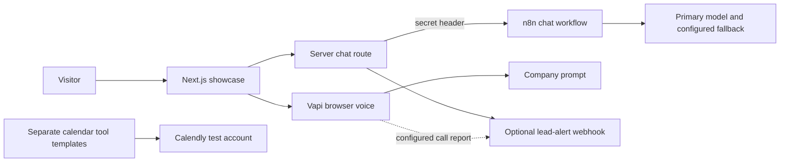

# AI Receptionist & Chat Workflows

**A business-facing Next.js demo with optional Vapi voice, n8n chat and lead-alert integrations.**

Built by **Bosko Tutnjilovic**, founder of [Synq Logic](https://synqlogic.com). [Company showcase](https://demo.synqlogic.com) · [Security and privacy](SECURITY.md)

This portfolio reference shows how a conversational assistant connects to business operations: a company-specific prompt, authenticated server-side chat, a voice interface, lead qualification signals and calendar workflow templates. The public copy starts with integrations disabled and contains no live account credentials.

## What works, and what is a simulation

| Component | Implementation / scope |
|---|---|
| Business demo website | Responsive UI, customizable business name / palette, service examples |
| Booking and quote UI | **Simulated** selections and results; no real appointment or payment |
| Browser receptionist | Real Vapi SDK integration when your public key and assistant ID are configured; scripted preview otherwise |
| Website chat | Next.js route forwards to your authenticated n8n webhook; needs your workflow and keys |
| Lead alerts | Server sender and an n8n Code-node helper for deduplication / daily caps; you configure the webhook and delivery nodes |
| Calendar tools | Sanitized n8n reference exports for availability and appointment creation; inactive, require your Calendly account and explicit testing |

The standalone phone calendar tools are separate templates from the browser demo. They are not attached by this repository, and their availability does not mean the company demo creates real calendar bookings. The original phone-agent notes described booking as unattached / test mode; this release makes no new deployment claim.

## What employers can inspect

- Company-specific prompts and unknown-answer boundaries.
- Private webhook secrets kept on the server.
- Input validation, timeouts, Origin checks and layered request limits.
- Call-report handling, chat-interest detection and bounded notification volume.
- Tool payload validation alongside a readable business interface.



## Run locally without live integrations

Requires Node.js 24+ and npm.

```bash
git clone https://github.com/skabo42000/ai-receptionist-workflows.git
cd ai-receptionist-workflows
npm ci
npm run dev
```

Open `http://localhost:3000`. Leave integration environment variables unset for the voice preview and simulated booking flow. Chat returns `chat_not_configured` until you configure its backend. The company showcase is configured independently from this sanitized copy.

```bash
npm run typecheck
npm run lint
npm run build
npm test
```

Automated checks do not place calls, send alerts or create appointments.

## Enable your own integrations

Copy `.env.example` to `.env.local`. Configure only the features you want:

- **Voice:** `NEXT_PUBLIC_VAPI_PUBLIC_KEY` and `NEXT_PUBLIC_VAPI_ASSISTANT_ID`. These are browser-visible identifiers. Restrict permitted domains and set spending / call limits in Vapi. Never use a private key in a `NEXT_PUBLIC_*` variable.
- **Chat:** `N8N_CHAT_WEBHOOK_URL` and `N8N_CHAT_SECRET`. The n8n endpoint must require `X-Chat-Auth`. Start with the [prompt template](n8n/anna-chat-system-prompt.md), select your primary / fallback providers, then return the response shape below. A full chat workflow export is not included.
- **Alerts:** `N8N_ALERT_WEBHOOK_URL` and `VAPI_SERVER_SECRET`. Require `X-Vapi-Secret` at the receiver. [The helper](n8n/lead-alerts-build-alert.js) prepares content, deduplicates and caps volume; your n8n workflow must authenticate first and route output to your chosen channel.
- **Calendar:** follow [n8n/README.md](n8n/README.md). Credentials and tenant settings are placeholders. Attach the write tool only after testing caller confirmation and failure handling.
- **Analytics:** off by default. `NEXT_PUBLIC_ENABLE_ANALYTICS=true` enables Vercel Analytics; review your privacy disclosure first.

Outbound integrations may cost money and transmit caller or visitor data. Enable them only in accounts you control. The reference booking link is `https://example.com/book`; replace it in the configuration and prompts with your own **test** booking page.

### Chat contract

Browser request to `POST /api/chat`:

```json
{"chatInput":"Do you support multilingual reception?","sessionId":"synthetic-session"}
```

The server forwards the message and session ID to n8n with the private header. n8n responds:

```json
{"output":"Yes. Supported languages depend on the voice and transcription providers you configure."}
```

Verify tool results before confirming a service, payment or appointment; escalate uncertain cases.

## Source map

| Path | Purpose |
|---|---|
| `components/voice/` | Vapi SDK lifecycle and microphone interface |
| `app/api/chat/`, `lib/rate-limit.ts`, `lib/request.ts` | Upstream chat and local request controls |
| `lib/alerts.ts`, `n8n/lead-alerts-build-alert.js` | Optional business notifications |
| `vapi/` | Assistant configuration and company prompt templates |
| `n8n/voice-agent-*.json` | Inactive availability / booking workflow and tool references |
| `components/booking/`, `components/quote/` | Simulated product flows |

## Limits

In-memory limits reset on restart and are per instance. Forwarded IPs are trustworthy only behind a proxy that overwrites incoming headers. Add shared limits and provider spending caps for public use. Prompts do not guarantee correctness or prevent prompt injection. Call recordings, transcripts, customer data and live credentials are excluded.

Stock photos and the included Instrument Serif typeface are described in [THIRD_PARTY_NOTICES.md](THIRD_PARTY_NOTICES.md).
