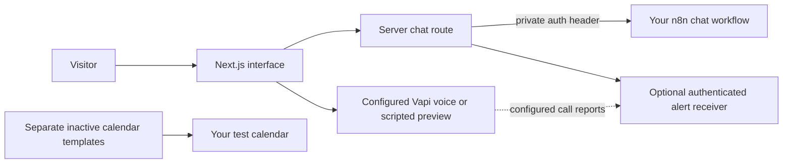

# AI Receptionist & Chat Workflows

A visitor asks what a business offers, tries a booking or quote flow, and decides whether to talk further. This Next.js demo shows that journey, with optional Vapi voice, authenticated n8n chat and lead alerts behind the interface.

**[Open the company showcase](https://demo.synqlogic.com)** · [Run the local preview](#run-the-local-preview) · [Workflow templates](n8n/README.md)

**Booking and quote flows are simulations.** This public repository is a sanitized reference with integrations disabled by default. The company showcase is configured separately; a clone does not connect to its accounts or create real appointments.

I built the project with AI coding agents, directing the business flow, prompts and checks.

Bosko Tutnjilovic · AI Automation Engineer · [Synq Logic](https://synqlogic.com)

## What you can inspect

For a short walkthrough, open the showcase and try the service, time-selection and quote screens. Treat their results as demonstrations. For a local preview without live voice, chat or alerts, follow the quickstart below.

A useful receptionist needs more than an answer box: a prompt that understands the business, a clear response when information is missing, a controlled route to the model, and a way to handle interest without pretending an appointment has been saved. The source separates these pieces.

| Component | What this repository includes |
| --- | --- |
| Business website | Responsive interface, sample services and configurable presentation |
| Booking and quote | Simulated selections and results; no real appointment or payment |
| Browser voice | Vapi SDK integration when configured; scripted preview otherwise |
| Website chat | Server route to your authenticated n8n webhook; you supply the chat workflow and keys |
| Lead alerts | Server sender and n8n helper; you supply authenticated receiving and delivery nodes |
| Calendar tools | Separate inactive availability and booking templates requiring your own account configuration |

The calendar templates are not attached to the browser demo. Importing a template is not proof of a working booking system. A full chat workflow export and an email-delivery node are not included.

## How the pieces connect



The project uses Next.js, TypeScript, Vapi and n8n. Inspect the company-specific prompts, server-only secrets, input checks, timeouts, Origin checks and request limits. These controls reduce specific risks; they are not a production security guarantee.

## Run the local preview

Requires Node.js 24+ and npm.

```bash
git clone https://github.com/skabo42000/ai-receptionist-workflows.git
cd ai-receptionist-workflows
npm ci
npm run dev
```

Open `http://localhost:3000`. Leave integration settings unset to use scripted voice and simulated booking. Chat returns `chat_not_configured` until its backend is configured; that is expected for this preview.

Source checks and offline tests:

```bash
npm run typecheck
npm run lint
npm run build
npm test
```

The automated tests do not place calls, send alerts or create appointments. These commands were checked against the source manifest, but were not executed for the October 25, 2026 documentation review.

## Configure your own integrations

Copy `.env.example` to `.env.local` and configure only the features you intend to use. External integrations may cost money and transmit visitor or caller data.

| Feature | Settings and contract |
| --- | --- |
| Voice | `NEXT_PUBLIC_VAPI_PUBLIC_KEY` and `NEXT_PUBLIC_VAPI_ASSISTANT_ID`; browser-visible identifiers. Restrict domains and configure call/spending limits in Vapi. Never put a private key in `NEXT_PUBLIC_*`. |
| Chat | `N8N_CHAT_WEBHOOK_URL` and `N8N_CHAT_SECRET`; require `X-Chat-Auth` at your webhook. Start with the [chat prompt](n8n/anna-chat-system-prompt.md) and create your own primary/fallback model flow. |
| Alerts | `N8N_ALERT_WEBHOOK_URL` and `VAPI_SERVER_SECRET`; require `X-Vapi-Secret` before running the [alert helper](n8n/lead-alerts-build-alert.js), then add your delivery node. |
| Calendar | Follow [n8n/README.md](n8n/README.md). Bind your own credentials and test event type. The booking workflow makes a real write when activated and invoked. |
| Analytics | Off by default; `NEXT_PUBLIC_ENABLE_ANALYTICS=true` enables Vercel Analytics. Review your privacy disclosure first. |

The reference booking link is `https://example.com/book`. Replace it in configuration and prompts with your own test booking page. Check a tool's result before saying a booking succeeded. A timeout can mean the outcome is unknown; inspect the calendar before retrying.

### Chat contract

Browser request to `POST /api/chat`:

```json
{"chatInput":"What can the receptionist help with?","sessionId":"synthetic-session"}
```

The server forwards the message and session ID to n8n with the private auth header. Your workflow returns an `output` string:

```json
{"output":"I can answer questions from the business information provided. If something is missing, I can point you to the business for help."}
```

This is an illustrative response shape, not a recorded model answer. Verify service, payment and appointment details before confirming them to a visitor.

## Source map

| Path | Purpose |
| --- | --- |
| `components/voice/` | Vapi lifecycle, microphone interface and preview |
| `app/api/chat/`, `lib/request.ts`, `lib/rate-limit.ts` | Authenticated upstream route and local request controls |
| `vapi/`, `n8n/anna-chat-system-prompt.md` | Business prompt and assistant references |
| `lib/alerts.ts`, `n8n/lead-alerts-build-alert.js` | Optional notifications and best-effort deduplication/caps |
| `n8n/voice-agent-*.json` | Separate inactive calendar references |
| `components/booking/`, `components/quote/` | Simulated product flows |

## Evidence, limits and reuse

The company showcase URL is recorded in the project evidence. Current hosted access, voice quality, provider behavior and the exact relationship between the hosted build and this public copy were not checked for the October 25, 2026 review. This repository does not establish client results, measured time savings or production-scale reliability.

In-memory request limits are per instance and reset on restart. Forwarded IPs are reliable only behind a proxy that overwrites incoming headers. Alert caps and deduplication are best-effort, and calendar writes have no durable exactly-once guarantee. Public use needs shared controls, provider spending limits and an appropriate data-retention policy.

Read [SECURITY.md](SECURITY.md). Live credentials, call recordings and transcripts are excluded. Photos and the Instrument Serif font are covered in [THIRD_PARTY_NOTICES.md](THIRD_PARTY_NOTICES.md); those notices do not establish a license for the project code. Code reuse terms remain to be set.
